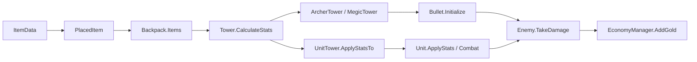

# Backpack Legions — Proje Durum ve İlerleme Raporu

**İnceleme tarihi:** 1 Ekim 2026 · **Editor:** Unity 2022.3.62f3 · **Sahne:** GameScane

## 1. Şu anda neredeyiz?

Projede yalnızca bir fikir veya birbirinden kopuk scriptler yok: kule satın alma, kuleye ait çanta, eşya statları, otomatik savaş, düşman ödülleri ve dalga sonu sonucu arasında çalışan bir temel var. Önceki yol haritasından sonra özellikle birlik kulesi ve dükkanın kalıcılığı ilerlemiş.

Buna karşılık GDD'nin oyunu farklılaştıran ana katmanları olan gerçek hazırlık/savaş döngüsü, yerleşime bağlı sinerjiler, craft, element evrimi, HQ/skilltree ve kalıcı ilerleme henüz tamam değil. En uygun değerlendirme **oynanabilir temel prototip**. “GDD bitti” veya “bilinen hiçbir engel yok” demek doğru olmaz.

Önceki belgenin “MVP tamamlandı, uçtan uca playtest yapıldı” kaydını geçmiş çalışma notu olarak korudum. Bu incelemedeki sınırlı testler o eski testin tamamını yeniden doğrulamıyor. Yeni bulgular yeni bir sağlamlaştırma listesi oluşturuyor; önceki emeği geçersiz kılmıyor.

## 2. İncelemenin dayanağı

| Kaynak | İncelenen kapsam |
|---|---|
| GDD V4 | Beş sayfa; döngü, grid, ekonomi, element, HQ, analiz, Bestiary ve kule modelleri. |
| Skilltree V1 | Dört sayfa; üç dal ve toplam 18 yetenek; olasılık/hız ve enflasyon test notları. |
| Eski yol haritası | Tamamlananlar, eski P0/P1/P2 kayıtları ve genişletilmiş modüller. |
| Oyun kodu | `Assets/Scripts` altındaki 30 C# dosyası; çağrı yolları ve eksik sistem taraması. |
| Unity canlı okuma | Açık sahne, oyun bileşenleri, prefab bağlantıları, ScriptableObject verileri, buton olayları ve eksik scriptler. |
| Sınırlı Play Mode | Mevcut satın alma metotlarıyla üç kule kurulumu; savaş ilerlemesi; birlik stat aktarımı; sonuç paneli. |

Asset paketlerinin bütün demo sahneleri tek tek incelenmedi. MainMenu'nün sahne listesinde bulunduğu ve geçiş kodu doğrulandı; menünün bütün etkileşimleri oynanmadı. Kayıt dosyası/harici VCS düzeni bilinmiyor. Proje klasöründe `git status` “not a git repository” verdi; bu, başka bir yedekleme yönteminin olmadığı anlamına gelmez.

## 3. Yapılan işlerin güncel özeti

| Sistem | Bugünkü durum | Açık kalan bölüm |
|---|---|---|
| Kuleye özel backpack | Her kule kendi `Backpack` nesnesini oluşturuyor. Grid/öğe listesi, şekil, sınır ve çakışma kontrolü var. | Rotasyon, craft, sinerji kuralları, bütün iptal/drag uç durumları. |
| Drag & drop | Mağaza ghost'u, yerleştirme, altın kontrolü, mevcut itemi taşıma ve başarısız taşımanın geri alınması kodda mevcut. | Bu tur fareyle uçtan uca doğrulanmadı; faz değişimi ve kule değişimi sırasında sürükleme güvenliği test edilmeli. |
| Kule satın alma | Üç tip bağlı: birlik 100, okçu 300, büyücü 400 gold. Slot doluluk ve iptal kodları var. | Savaşta satın alma izni ve UI isim/ikon/olay eşleşmesi. |
| Dükkan | Kule tipi + rarity; dört slot; kule başına saklanan teklifler; satın alınan teklifin silinmesi; 10 gold reroll. | Freeze, dalga başı ücretsiz reroll, element havuzları, refund. |
| Saldırı statları | Item bonuslarından hasar/kritik/cooldown hesaplanıyor. Mermiler bunları alıyor. | Temel stat kaynağı tutarsızlığı ve ileride çarpan sırası. |
| Okçu/büyücü | İki sınıf da `Tower` tabanını kullanıyor; mermi `Initialize()` çağrıları mevcut. | Seçilebilir hedefleme, büyücü AoE, element uzmanlığı, skilltree. |
| Birlik kulesi | Artık `Tower` türevi; çanta/dükkan/stat aktarımı var. Üç asker, angajman ve yeniden üretim kodları mevcut. | XP/element/skilltree; karşı saldırı ritmi ve slot kapasitesi kararları. |
| Düşman | NavMesh ile kaleye gidiyor; weakness/resistance ve ölüm gold'u var. | Hava türü, bağımsız element kimliği, zırh/stun gibi skilltree ihtiyaçları. |
| Wave | Sahnede 10 Goblin + 1 Boss + 1 Boss + 1 Boss olmak üzere dört test dalgası. | Ara dalgalarda temizlenmeyi bekleme/hazırlık yok; 20 bölüm ve ölçekleme yok. |
| Kale/sonuç/pause | Hasar, game over, sonuç metni, pause/continue/restart/menu kodu var. | Sağlam durum geçişleri, kalp güncellemesi ve analiz UI. |
| Sinerji | `synergyIDs` alanı var; `SynergyLineManager` boş. | İşleyen sinerji sistemi henüz yok. |
| Skilltree/HQ/Bestiary | Tasarım belgelerinde var. | İncelenen oyun kodunda uygulama bulunmadı. |

Canlı veri envanteri: üç kule prefabı, iki mermi prefabı, iki düşman prefabı, bir asker prefabı; üç TowerData, iki EnemyData, iki BulletData; 29 mağaza itemi + üç varsayılan silah. Build listesinde MainMenu ve GameScane etkin. Üç kule verisinin grid boyutu 5×5.

## 4. Mevcut kod nasıl çalışıyor?

Bu bölüm yeni mimari önerisi değil, mevcut akışın açıklamasıdır.

### Kule kurma ve veri sahipliği

`TowerSlot.OnMouseDown()` seçilen yeri UI'a bildiriyor. `UİManager` seçilen kule tipini tutuyor ve `BuyTower()` ilgili prefabı oluşturuyor. Fiyat prefabın `TowerData.cost` değerinden geliyor. Kule `Start()` içinde kendine bir `Backpack` oluşturuyor, ana silahını merkeze koyuyor, statlarını hesaplıyor ve dört shop teklifini üretiyor.

`ItemData` eşyanın ortak tasarım bilgisi; `PlacedItem` o eşyanın belirli çantadaki konumu. Böylece aynı eşya asset'ini iki kule kullanabilirken yerleşimler ayrı kalıyor. `TowerData` da paylaşılan veri; kule seviyesi ve hesaplanan statlar ise kule instance'ında tutuluyor. Bu ayrım projede mevcut ve korunmaya değer, ancak gelecekteki sorumluluk dağılımını yine birlikte kararlaştıracağız.

### Eşya ve hasar akışı

`BackpackDraggable` taşınan eşyanın eski yerini geçici olarak boşaltıyor. Bırakıldığında alan ve gold uygunsa yerleştiriyor; uygun değilse eski itemi geri koyuyor. Ardından görselleri yeniliyor ve `CalculateStats()` çağırıyor. Mağaza tarafındaki `ShopSlotDragStarter`, başarılı satın almadan sonra ilgili kule teklifini temizliyor.

Şu anki formüller:

- Hasar = `baseDamage × (1 + toplam damageBonus)`.
- Kritik şans = `baseCriticalChance + toplam criticalChanceBonus`.
- Atışlar arası süre = `max(0.1, baseAttackSpeed / (1 + toplam attackSpeedBonus))`.
- Birlik max canı = prefab temel canı × `(1 + toplam healthBonus)`; kalan can eski/yeni max can oranıyla ölçekleniyor.

Burada `attackSpeed` adındaki değer fiilen saniye cinsinden bekleme süresi. Hız arttıkça sayı küçülüyor. İsimlendirmeyi değiştirme kararı alınmadı; kodu okurken bu ayrım önemli.

`UnitTower.CalculateStats()` önce taban hesabını yapıyor, sonra yaşayan askerleri güncelliyor. Yeni doğan asker de aynı aktarımı alıyor. Örneğin Lejyoner Kılıcı +%10 hasar verdiği için temel 10 hasar 11 oluyor. Deri Kalkan +%20 can verdiğinde 100 max can 120'ye çıkıyor; 50 canı kalan asker 60'a çıkıp yine yarı canlı kalıyor.

### Şu an faz yerine ne var?

`GameManager.Start()` zamanı sıfırlıyor; Başlat zamanı 1 yapıyor. `WaveManager.Start()` ise coroutine'i hemen başlatıyor. Coroutine ilk düşmanı ilk beklemeden önce ürettiği için oyun durmuş olsa bile o düşman oluşuyor. Ara dalgalar sabit arayla ilerliyor; yalnız son dalga bütün düşmanların kaybolmasını bekliyor. Bu nedenle zaman durdurma ve gerçek hazırlık/savaş durumu şu anda aynı şey değil.

## 5. Öncelikli bulgular ve gerekçeleri

### A. Temel kule statlarının veri kaynağı uyuşmuyor — canlı doğrulandı

[Tower.cs:17](C:/Users/Emir/BackPackDefance/Assets/Scripts/Tower.cs:17) kendi 10 hasar, %10 kritik ve 1 saniye başlangıç değerlerini tutuyor. `Start()` TowerData'dan menzil, grid ve varsayılan silahı alıyor; damage/attackSpeed/towerLevel değerlerini almıyor.

Canlı örnek: büyücü verisinde damage=25, gerçek başlangıç hasarı=10. Okçu verisinde attackSpeed=2, gerçek bekleme süresi=1. Bu, Inspector'da dengeleme yaptığında oyunda neden değişmediğini açıklayabilir. Hangi alanın yetkili kaynak olacağına karar vermeden düzeltme yapılmadı.

### B. Faz ve oyun sonu geçişleri korunmuyor — bir bölümü canlı, bir bölümü kod incelemesi

[WaveManager.cs:20](C:/Users/Emir/BackPackDefance/Assets/Scripts/WaveManager.cs:20) nedeniyle Başlat öncesinde bir düşman oluştuğu görüldü. [GameManager.cs:41](C:/Users/Emir/BackPackDefance/Assets/Scripts/GameManager.cs:41) Escape/Continue akışı hazırlık veya sonuç durumunu kontrol etmeden zamanı yeniden 1 yapıyor. Bu ikinci durum bu tur kullanıcı girdisiyle yeniden üretilmedi; kod yolu açık.

Savaşta kule/çanta/shop tıklamasını ve işlemleri engelleyen bir faz kontrolü de yok. Bu eksik, eski dar MVP'nin bilinçli kapsam dışı olabilir; GDD döngüsünün tamamlanması için yine gerekli.

### C. Sahnede 28 eksik script bileşeni var — canlı doğrulandı

25 eski `GridLayout/Button` nesnesi, item shop paneli, `GameManager` ve `BackpackManager` üzerinde birer eksik script var. Bunlar otomatik silinmedi: önce hangilerinin eski sistem kalıntısı olduğunu birlikte belirlemeliyiz. Kontrol anlarında Console sıfır hata/uyarı döndürdü; bu sonuç eksik bileşenleri yok saydırmaz.

### D. Birlik saldırı hızı düşmanın karşı saldırı hızını da değiştiriyor — tasarım kararı gerekli

[Unit.cs:62](C:/Users/Emir/BackPackDefance/Assets/Scripts/Unit.cs:62) her asker vuruşunun ardından `Enemy.AttackTarget()` çağırıyor. Düşman kendi saldırı süresini saymıyor. Sonuç olarak saldırı hızını artıran bir eşya askerin daha sık karşı hasar almasına da neden olabilir. Bu istenmiş olabilir; otomatik olarak bug sayıp mimariyi değiştirmedim.

### E. Kale kalbi değerlendirmesi yeniden açılmalı — koddan belirlenen uç durum

Canlı sahnedeki iki Base'in maxHealth değeri 100; dosyadaki varsayılan 10000 test değeri sahnede kullanılmıyor. Bununla birlikte [Base.cs:29](C:/Users/Emir/BackPackDefance/Assets/Scripts/Base.cs:29) içindeki sıfıra düşüş dalı Heart1'i, sonraki ayrı koşul Heart3'ü kapatıyor; Heart2'yi kapatan `else if` atlanıyor. Örneğin 100→0 tek vuruşta orta kalp açık kalabilir. Yani “100 can için tamamen doğru” kaydı fazla güçlüydü.

### F. İçerik ve bağlantı temizliği — doğrulanmış veri, etkisi ayrıca test edilecek

- İki aktif kale bileşeni var. `PlaneTestMVP/Base` Base etiketli; `PlaneTest/Base` Untagged. Dolayısıyla iki Base etiketinden doğan belirsiz hedef seçimi tespit edilmedi. İkinci test alanının gerekliliği açık.
- Büyücü/okçu adlı satın alma düğmelerinin kayıtlı metotları isimlerle ters eşleşiyor. Görsel etiketler kontrol edilmeden “yanlış kule alınıyor” denemez.
- FastEnemy verisinde Normal hem weakness hem resistance listesinde. Mevcut `if/else if` nedeniyle weakness kazanıyor ve ×1.5 uygulanıyor.
- Her iki mermi verisi de Normal. Skilltree'deki element karşılaştırmalarını destekleyecek ayrı düşman elementi henüz yok.
- Dükkan itemID 5–10 değerlerinin her biri iki asset'te tekrar ediyor. Bugünkü referans tabanlı mağazayı zorunlu olarak bozmaz; kimlik temelli kayıt/craft/sinerji eklenmeden önce temizlenmeli.
- Dört itemde centerOffset şeklin dışındaki `(1,1)` hücresinde. Yerleştirme hissi için kontrol gerekiyor.
- Shop havuzunda her tip/rarity için en az bir item var; mevcut veride boş havuz hatası bulmadım. Fakat [ShopManager.cs:48](C:/Users/Emir/BackPackDefance/Assets/Scripts/ShopManager.cs:48) boş listeyi korumuyor. İçerik düzenlemesi bu riski açabilir.
- `UpgradeTower()` var fakat taramada bir oyun çağırıcısı bulunmadı. Bu, XP/seviye sisteminin uygulandığı anlamına gelmez; rarity tablosu yalnız 1–5 arası.

İkincil bakım notları: `Base.TakeDamage()` her çağrıda UI arıyor; `UİManager` isim tabanlı aramalar ve satın alma sorumluluğunu birlikte taşıyor; bazı kod yorumlarında bozuk Türkçe karakterler ve eski alanlar var. Bunlar toplu refactor gerekçesi olarak kullanılmayacak; ilgili iş sırasında küçük ve açıklanan değişikliklerle ele alınabilir.

## 6. GDD ve skilltree'nin açığa çıkardığı kararlar

| Konu | Neden önce konuşmalıyız? |
|---|---|
| Rotasyon | GDD istiyor, mevcut kod bilinçli olarak çıkarmış. GDD'yi mi uygulayacağız, tasarımı mı güncelleyeceğiz? |
| Element enflasyonu | `1+0.10n` üçüncü değişimde 1.30; `1.10^n` üçüncü değişimde 1.331. Belgedeki ifade/örnek farklı hesaplar. |
| Element sözlüğü | Kod Normal/Fire/Water/Earth/Air; skilltree Ateş/Doğa/Buz ve Neutral Enemy kullanıyor. |
| Skilltree kapsamı | Run içi HQ harcaması veya kalıcı ilerleme seçenekleri açık. Para, save ve reset bundan etkileniyor. |
| Kritik hesap | Kritik Odak +%10 yüzde puanı mı? x2 bütün hasara mı yalnız item katkısına mı? Mevcut mermi çarpanı zaten 2, asker 1.5. |
| Büyücü yetenekleri | Mevcut büyücü tek hedefli; AoE, büyü item etiketi, element değişimi ve dalga süresi altyapısı gerekir. |
| Kıyamet Sevdalısı | Savaşta element değişimi yasaksa hazırlıktaki değişimin “dalga sonuna kadar” bonusu hangi dalgada işler? |
| Birlik yetenekleri | Çifte Sancak kapasite aşabiliyor; mevcut üretim sabit slot sayısına göre. Lejyoner Sinerjisi kendini sayıyor mu, sınırı var mı? |
| Hedefleme | “Kara/hava öncelikli” metni yalnız o türü hedefleme diyor. Uzak seçimi mesafe veya yol sırası diye iki anlam içeriyor. |
| Craft / refund / XP | Tarif, maliyet tabanı, yuvarlama, ana silah ve XP sahipliği ayrıntıları henüz belli değil. |

## 7. Bundan sonra nasıl ilerleyelim?

Önerim önce bir bölümü güvenilir biçimde oynatmak; sonra oyun kararlarını derinleştirmek. Yirmi bölüm veya 18 yeteneği aynı anda yazmak, şu andaki döngü sorunlarını çoğaltır ve kodu takip etmeyi zorlaştırır.

1. **Doğruluk turu:** temel stat kaynağı, başlangıç/sonuç sınırları, eksik scriptlerin ayrımı. Her sorun için beklenen örnek ve küçük test.
2. **Hazırlık–savaş döngüsü:** geçişler, kilitler, dalga bitişi, ücretsiz reroll/Freeze ve hız. Bu bölümün sorumluluklarını Emir'in önerdiği mimari üzerinden tartışırız.
3. **Backpack stratejisi:** karar sonrası rotasyon, sinerji ve craft; refund. Birkaç anlamlı eşya kombinasyonuyla farkı ölçeriz.
4. **Hedefleme ve element/XP:** ilk olarak tek kule üzerinden baştan sona sınıf seçimi ve shop değişimi; sonra diğer tiplere genişletme.
5. **HQ/skilltree ve analiz:** önce bir basit pasif, etkisinin ölçümü ve satın alma akışı; sonra özel tetiklenen yetenekler. Tam analiz UI'ından önce doğru ölçüm gerekir.
6. **Kalıcı ilerleme ve içerik:** Bestiary/save kararları, bölüm geçişi, ölçekleme ve 20 bölüm; örnek bölümden öğrenilen dengeyi yayma.

Bu sıra kesin mimari veya süre tahmini değil. Ayrıntılı checkbox'lar ve 18 yeteneğin ihtiyaçları [güncel yol haritasında](C:/Users/Emir/BackPackDefance/Docs/Backpack_Legions_Yol_Haritasi.md).

## 8. Kod hâkimiyetini koruyacak çalışma biçimi

Her geliştirme işini şu kısa döngüyle ilerleteceğiz:

1. **Beklenen davranış:** oyuncu ne yapacak, hangi sonuç oluşacak? Bir veya iki somut örnek.
2. **Senin yaklaşımın:** önce sorumlulukları nasıl dağıtmak istediğini dinleyeceğim. Alternatif sunarsam nedenini ve bedelini açıklayacağım.
3. **Dar değişiklik:** birlikte seçilen yaklaşımın en küçük çalışan parçası; kararlaştırılmamış sistemi araya eklemeyeceğim.
4. **Kod anlatımı:** değişen dosyalar/metotlar, yeni alanların sahibi ve yaşam süresi, çağrı sırası, stat/gold hesabı, Inspector bağlantıları ve olası hatalar.
5. **Birlikte doğrulama:** beklenen sayı ile gerçekleşen sayı; normal kullanım ve bir iptal/hata senaryosu. Otomatik test gerekiyorsa gerçek davranışı test ederiz.
6. **Kayıt:** yol haritasına “uygulandı” ve “test edildi” ayrı işlenir; açık sorular silinmez.

İlk görüşme önerim: **“Kule temel statlarının kaynağı ne olmalı ve hazırlık/savaş durumunu mevcut sınıflar arasında nasıl yönetmek istiyorsun?”** Bu raporda cevapları senin yerine verilmedi.

## 9. Yapılan doğrulamalar ve sınırları

| Kontrol | Sonuç / sınır |
|---|---|
| Başlangıç | Play açık, timescale=0, gold=1000; Başlat öncesi bir düşman oluşmuştu. |
| Üç kule satın alma | Var olan seçim/satın alma metotları çağrıldı; 800 gold harcandı. Fare tıklama/ikon testi değil. |
| Kule başlangıç verisi | Üçünde bir varsayılan eşya, dört shop slotu; gerçek temel değerler 10 / 0.1 / 1. |
| Birlik savaşı | Üç asker görüldü; can azalmaları ve düşman ödülüyle gold artışı gözlendi. |
| Savaş sonu | Düşman=0, sonuç paneli açık, iki Base bileşeni de 100 can. Kazanma koşuluyla tutarlı. Kaybetme testi yapılmadı. |
| Birlik item katkısı | Play Mode içinde kontrollü olarak kılıç ve kalkan eklendi; hasar 10→11, can 50→60 / 80→96 / 60→72. Sonra itemler kaldırıldı. Shop/drag testi değil. |
| Console | Örneklenen anlarda hata/uyarı kaydı gelmedi. İlk tanılama ifadesi, henüz Start çalışmamış kulede null çanta okuyunca araç tarafında hata verdi; arka plan çalışması geçici açılıp güvenli tekrar okumada düzeldi. Oyun bug'ı olarak kaydedilmedi. |
| Sahne temizliği | Eksik script sayısı ayrıca tarandı: 28. Temel UI, spawn ve prefab referansları doğrudan referans kontrolüyle bağlı bulundu. |
| Geri dönüş | Play kapatıldı; GameScane dirty=false, test kuleleri yok, geçici runInBackground ayarı tekrar false. |

Bu tur oyun scriptleri, prefablar veya sahne dosyaları değiştirilmedi. Unity içinde yalnız inceleme ve geçici test komutları yürütüldü. Kalıcı çıktılar bu rapor, güncel yol haritası, önceki yol haritası arşivi ve inceleme kayıtlarıdır. Otomatik test/build, her UI akışı, istatistiksel kritik oranı ve 1×/2×/3× denge testi yapılmadı.

## 10. Belge kayıtları

- Güncel yol haritası: [Backpack_Legions_Yol_Haritasi.md](C:/Users/Emir/BackPackDefance/Docs/Backpack_Legions_Yol_Haritasi.md)
- Önceki belgenin değişmemiş arşivi: [2026-10-01 öncesi](C:/Users/Emir/BackPackDefance/Docs/Archive/Backpack_Legions_Yol_Haritasi_2026-10-01_Oncesi.md)
- Tasarım kaynakları: `C:/Users/Emir/Desktop/Backpack_Legions_GDD_V4.pdf` ve `C:/Users/Emir/Desktop/Backpack_Legions_Skilltree_System_V1.pdf`. Kaynak PDF'ler değiştirilmedi.

Eski belgede kalan doğrulanmış düzeltmeler korundu; güncelliğini yitirmiş Barracks ve kritik şans maddeleri değiştirildi; craft, skilltree, kayıt gereksinimi ve yeni bulgular eklendi. Uygulama ile tasarım hedefinin birbirine karışmaması için test kapsamı açık yazıldı.
